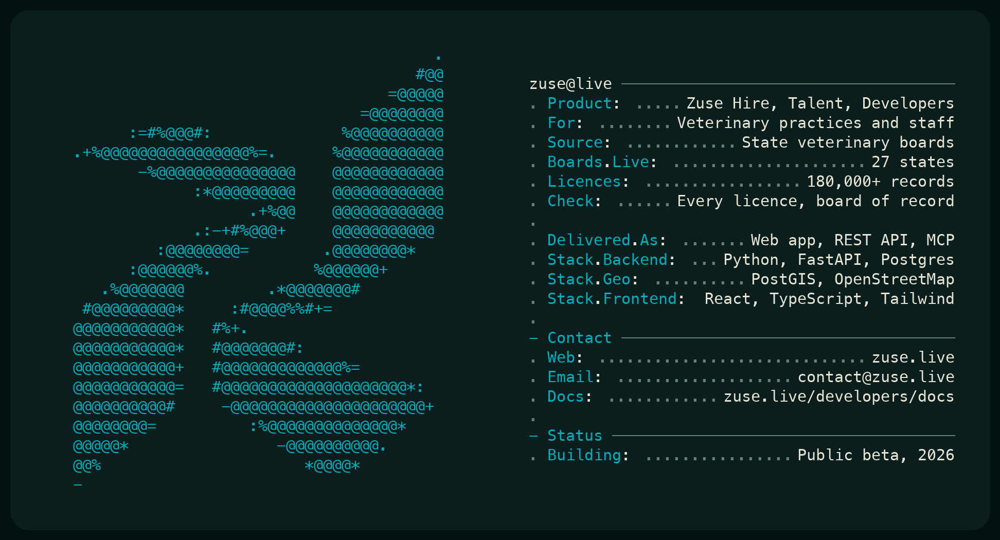

  

## About

Zuse finds the licensed veterinary people near any practice and checks each one against the state board of record. Licence records are public, but they sit on dozens of separate board websites, so a practice that is hiring cannot easily see who is actually licensed and living nearby. Zuse reads the boards, keeps the records current, and puts them on one map.

## Products

| | |
|---|---|
| **[Zuse Hire](https://zuse.live/hire)** | For practices. Every licensed vet and tech near a ZIP code, their licence status, and a place to manage openings. |
| **[Zuse Talent](https://zuse.live/talent)** | For vets, techs and assistants. Jobs near you from practices' own job boards, and a profile practices can trust. |
| **[Zuse Developers](https://zuse.live/developers)** | The same licence records over a REST API and an MCP server, for platforms that need them. |

## Principles

- **The board is the source.** Every licence shown traces back to the state board that issued it.
- **Public records, used with care.** People can ask to be left out, and they are.
- **Built for one industry.** Veterinary care only, so the details are right.

## Links

